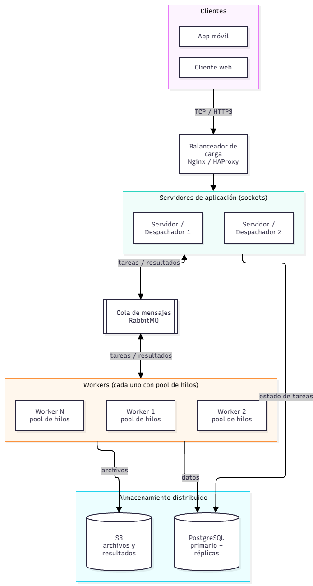

# PFO 3 – Rediseño como Sistema Distribuido (Cliente-Servidor)

Sistema distribuido simple en Python con **sockets TCP**: un servidor recibe tareas de clientes y las reparte entre varios **workers**, cada uno con su **pool de hilos**. Los resultados vuelven al cliente que envió la tarea.

## Diagrama de arquitectura




### Lectura del diagranma

| Componente | Rol |
|---|---|
| Clientes (móvil / web) | Envían tareas y esperan resultados. |
| Balanceador (Nginx/HAProxy) | Reparte las conexiones entre varios servidores y permite escalar o reemplazar uno sin cortar el servicio. |
| Servidor / despachador | Recibe tareas por socket, las encola y devuelve el resultado al cliente correcto. |
| RabbitMQ | Desacopla servidores y workers: si un worker se cae o hay picos de carga, las tareas esperan en la cola. |
| Workers | Ejecutan las tareas en paralelo con un pool de hilos cada uno. |
| PostgreSQL / S3 | Persistencia: datos relacionales (estado de tareas, usuarios) y objetos/archivos grandes. |


Operaciones disponibles: `suma`, `factorial`, `primo`, `mayusculas`, `invertir`, `dormir` (simula trabajo lento).

## Cómo ejecutar el codigo !


```bash
python server.py                     # 1. servidor
python worker.py --threads 4         # 2. worker (repetir en otras terminales para más workers)
python worker.py --threads 4
python client.py                     # 3. cliente con tareas de demostración
python client.py --task factorial 30 # aqui sacamos factorial
python client.py --task suma "[1,2,3]" # aqui suma de valores
```

Para usar otra máquina: `python worker.py --host IP_DEL_SERVIDOR` y `python client.py --host IP_DEL_SERVIDOR`.

## Ejemplo de salida

```
<- tarea 2 (factorial) [worker 2]: 2432902008176640000
<- tarea 1 (suma) [worker 1]: 15
<- tarea 9 (factorial) [worker 1]: ERROR: factorial() not defined for negative values
<- tarea 10 (raiz) [worker 2]: ERROR: operación desconocida: raiz
```

